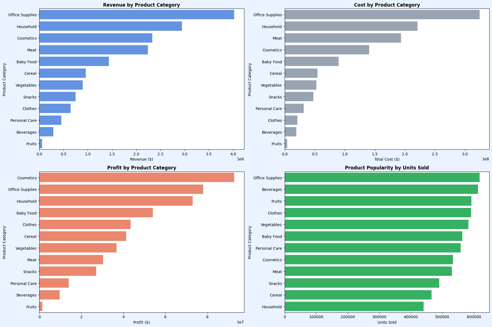
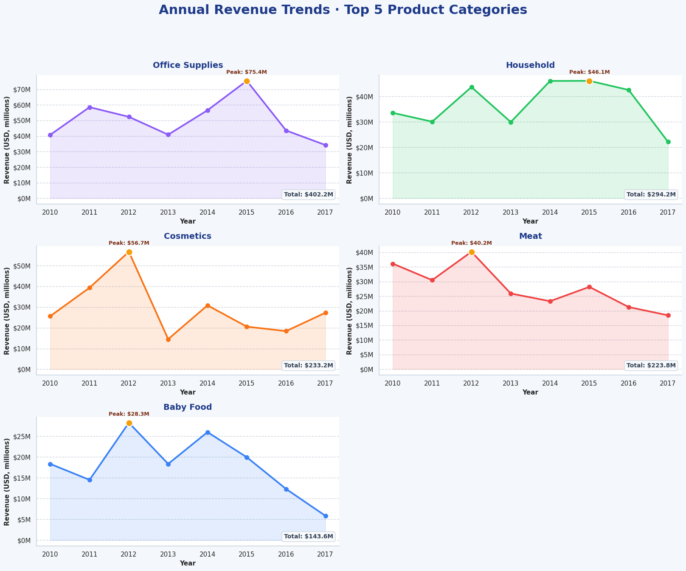

# Sales and Profitability Analysis with Python

**Maksym Voronenko | Data Analyst**

An exploratory analysis of order data enriched with country and product information. The project examines revenue, costs, profit, sales channels, order-to-ship intervals, and sales patterns over time.

**Tools:** Python, pandas, Matplotlib, Seaborn, Google Colab.

[View the notebook](sales_analysis.ipynb) · [Original Colab notebook](https://colab.research.google.com/drive/1GwCl7t_nFCVcWKwZcruuPjmrOWuNM9pp)

## Analysis Workflow

- Standardize country and product identifiers and join three source tables.
- Inspect missing values and duplicates, remove records with missing units sold, and parse dates.
- Calculate revenue, total cost, profit, profit margin, and average order value.
- Compare product categories, countries, regions, and online/offline sales channels.
- Analyze the interval between order and shipment dates.
- Explore monthly, quarterly, annual, and weekday sales patterns.

## Saved Results

The figures below come from the notebook's saved outputs.

| Metric | Value |
| --- | ---: |
| Orders | 1,328 |
| Revenue | $1,702,129,408.21 |
| Profit | $501,434,459.00 |
| Profit margin | 29.46% |

- Office Supplies leads category revenue at approximately $402.2 million.
- Cosmetics has the highest category profit at approximately $92.7 million.
- Offline and online channel profits are approximately $253.5 million and $248.0 million, respectively.

## Visualizations

### Product Category Performance

### Annual Revenue Trends

[View the weekly sales index chart](images/weekly_sales_index.png)

## Input Data

| Required file | Purpose |
| --- | --- |
| `events.csv` | Order records, dates, sales channels, quantities, prices, and costs |
| `countries.csv` | Country codes, country names, regions, and sub-regions |
| `products.csv` | Product identifiers and product categories |

The input CSV files are not included. The notebook expects them at `/content/countries.csv`, `/content/events.csv`, and `/content/products.csv`.

## Run in Google Colab

1. Open `sales_analysis.ipynb` in Google Colab.
2. Upload the three required CSV files into the runtime under `/content/`.
3. Run the cells in order from the top.

## Validation

The notebook JSON and Python syntax were checked. A duplicate plotting cell that referenced a variable before its definition was removed. Saved tables and charts were retained; the analysis was not rerun because the source CSV files were unavailable.
